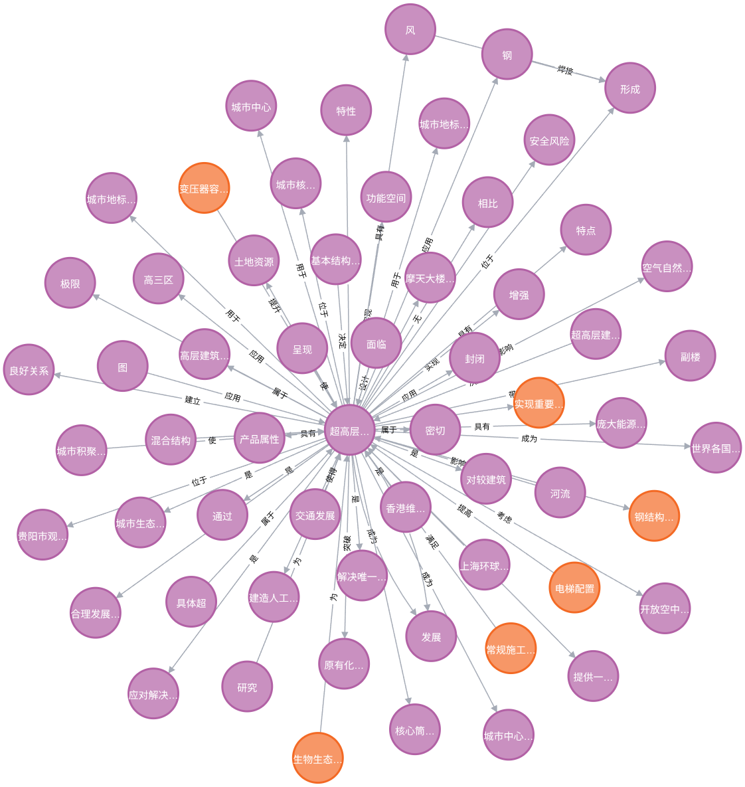

# Knowledge Graph QA for High-Rise Buildings

超高层建筑知识图谱问答系统

An end-to-end pipeline that turns Chinese research papers on super high-rise buildings into a Neo4j knowledge graph, plus a Streamlit app that answers simple questions over the graph.

```
paper PDFs → text (PyPDF2) → HanLP dependency parsing → rule-based (subject, relation, object) extraction
           → knowledge_graph.csv → Neo4j → Streamlit QA app (question patterns → Cypher)
```

<p align="center">
  
  <br>
  <em>The neighbourhood of 超高层建筑 (super high-rise building) in the graph, viewed in Neo4j Browser.</em>
</p>

## Results

| | |
|---|---|
| Source corpus | 186 Chinese papers and articles ([titles](data/source_papers.md); full texts not included) |
| Unique triples | 13,661 |
| Relation types | 1,643 |
| Distinct entities | ~16,500 |

## How it works

**1. PDF to text** (`pdf_to_text.py`)

Batch-converts the paper PDFs in `data/pdf/` to UTF-8 text files in `data/split/` with PyPDF2, page by page, and writes a conversion log with success/failure counts.

**2. Triple extraction** (`extract_relations.py`)

- Splits each text into sentences, skipping very short lines and formula-heavy lines.
- Runs HanLP's multi-task model (`CLOSE_TOK_POS_NER_SRL_DEP_SDP_CON_ELECTRA_SMALL_ZH`) for tokenization, POS tagging and dependency parsing.
- Builds a dependency tree, finds the main predicate, takes the subject and object from `nsubj`/`SBV`/`top` and `dobj`/`VOB`/`attr`/`pobj` arcs (with fallbacks), and expands each with its modifier children.
- Maps predicates onto 21 synonym groups (e.g. 位于 / 坐落 / 地处 → 位于), cleans entities, filters by length, stopwords and POS, removes duplicates, and writes `data/neo4j_data/knowledge_graph.csv`.

**3. Graph import** (`import_to_neo4j.py`)

Loads the CSV into Neo4j as `(:Entity {name})` nodes, with one relationship type per relation, e.g. `(承载能力)-[:满足]->(结构变形要求)`.

**4. QA app** (`qa_app.py`)

A Streamlit page that recognises three question patterns and answers them with parameterized Cypher queries:

| Pattern | Example question | Answer from the graph |
|---|---|---|
| X满足什么 | 承载能力满足什么？ | 结构变形要求 |
| 谁满足Y | 谁满足规范要求？ | 梁布置，稳定性，承载力，… |
| X是什么 | 法兹勒·卡恩是什么？ | 孟加拉裔结构工程师 |

**5. Neural extraction experiment** (`casrel/`)

A simplified PyTorch implementation of CasRel ([Wei et al., ACL 2020](https://arxiv.org/abs/1909.03227)) on `bert-base-chinese`: a subject start/end tagger, followed by one object tagger per relation that is conditioned on the subject's representation.

- `generate_data_files.py` writes the training data: 5 hand-labelled sentences (17 annotated subject–relation–object groups, 49 relation labels).
- `train.py` fine-tunes the model for 50 epochs (BCE loss, Adam, lr 2e-5).
- `predict.py` and `batch_extract.py` run the trained model over paper texts (two decoding variants).

This was a small-data feasibility test. Run over about 80 papers, its output was mostly noise, so it was **not** merged into the graph above. Making it useful would need a few hundred labelled sentences with normalized relation types, a held-out test set to compare it against the rules, and sentence-level inference instead of truncating each paper at 512 tokens.

To run it: put `bert-base-chinese` from Hugging Face in `casrel/models/bert-base-chinese/` and the `.txt` files in `casrel/input_txts/`, then from `casrel/` run `python generate_data_files.py`, `python train.py` and `python predict.py`.

## Quick start

The project was developed with Python 3.9, and you need a running Neo4j database (4.x or 5.x). Credentials are read from environment variables, never from the code.

```bash
pip install -r requirements.txt

export NEO4J_URI=bolt://localhost:7687
export NEO4J_USER=neo4j
export NEO4J_PASSWORD='your-password'

python import_to_neo4j.py    # load the CSV into Neo4j (safe to re-run)
streamlit run qa_app.py      # opens the QA page in your browser
```

To rebuild the graph from your own papers, put the PDFs in `data/pdf/` and run `python pdf_to_text.py`, then `python extract_relations.py` (optionally with a stopword list at `data/stopwords_full.txt`). The HanLP model downloads on the first run.

## Limitations and next steps

- Extraction is rule-based with no learned filter, so some triples are fragments of words or phrases.
- The `Subject_Category` / `Object_Category` columns are assigned from the predicate's POS tag rather than each entity's own tag, so almost every entity is labelled `Action` or `Technology`. Typing entities by their own POS/NER tags is the next fix.
- The QA app only understands three exact-match patterns.
- Next steps: more labelled data so the CasRel model can be evaluated against the rules on a held-out set, entity linking for fuzzy matches, and LLM answers grounded in triples retrieved from the graph.

## Tech stack

Python · [HanLP](https://github.com/hankcs/HanLP) · PyTorch · Transformers (BERT) · Neo4j / Cypher (py2neo) · Streamlit
